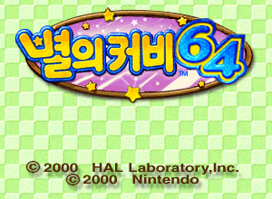
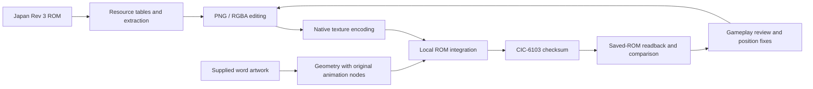

<p align="center">
  
</p>

<h1 align="center">별의 커비 64 한국어화</h1>

<p align="center">
  <strong>Kirby 64 Korean Localization Kit</strong><br>
  Nintendo 64 그래픽·글자 모델 분석과 한국어화 빌드 도구
</p>

<p align="center">
  Target: <code>Hoshi no Kirby 64 (Japan) (Rev 3)</code> · Nintendo 64<br>
  Build host: Windows + Python · ROM format: big-endian <code>.z64</code><br>
  Title texture preview: <code>b0_0025</code>
</p>

별의 커비 64의 타이틀, 메뉴, 미니게임, 적 이름, 조작 안내와 제작진 그래픽을 한국어화하면서 만든 도구와 편집 자료를 모은 저장소입니다. 이미지의 팔레트와 원래 배치를 유지하는 작업부터, 글자별로 움직이는 폴리곤 모델을 교체하고 ROM에 다시 넣는 과정까지 다룹니다.

게임 화면에서 위치를 확인한 뒤 이미지를 수정하고, 빌드된 ROM에서 자산을 다시 꺼내 대조하는 방식으로 작업하고 있습니다. 원본 리소스의 경계, 이미지 헤더, 행 패딩, 애니메이션 참조와 수정하지 않은 바이트를 보존하는 것이 도구의 기본 원칙입니다.

**English summary.** This repository contains tools and edited assets for a Korean localization of Kirby 64, targeting the Japanese Rev 3 ROM. It covers sprite extraction and native-format encoding, palette handling, diagnostic glyphs, internal ASCII strings, animated word geometry, ROM rebuilding, and readback validation. The latest local build contains 350 edited PNG resources and two artwork-based Korean word models; the public asset snapshot and local production workspace are described separately below.

> [!NOTE]
> 원본 ROM과 완성 ROM은 저장소에 포함하지 않습니다. 도구를 실행하려면 아래 SHA-1과 일치하는 일본어판 Rev 3 원본을 별도로 준비해야 합니다. 추출 원본, 최신 RGBA 편집본과 연구 기록도 현재 Git 추적에서 제외되어 있습니다.

## Contents

- [Project status](#project-status)
- [Engineering scope](#engineering-scope)
- [How Korean graphics reach the game](#how-korean-graphics-reach-the-game)
- [Repository and local workspace](#repository-and-local-workspace)
- [Requirements](#requirements)
- [Quick start](#quick-start)
- [Tool reference](#tool-reference)
- [Animated word models](#animated-word-models)
- [Translation conventions](#translation-conventions)
- [Verification](#verification)
- [Known limitations](#known-limitations)
- [References and acknowledgements](#references-and-acknowledgements)

## Project status

The following development status reflects the local **v4 build, 2026-11-12**. Gameplay review and position adjustments are ongoing.

| Area | Current development status | Public repository contents |
|---|---|---|
| Title, menus and system graphics | Korean graphics prepared and incorporated into local builds | Native-format PNG snapshot in `workspace/edits/` |
| Minigames, enemy names and tutorial text | Translation graphics prepared; positions adjusted during gameplay review | Translation inputs, asset metadata and edited PNG snapshot |
| Staff roll | Japanese staff-roll graphics rendered in English | Edited staff-roll PNGs |
| HUD themes and numeral graphics | 29 corresponding graphics adapted from the US version in the local workspace | The latest additions remain in the local RGBA set |
| Boss-result word models | `형편없네요` and `축하합니다!` converted from supplied artwork and incorporated into ROM builds | Both geometry BIN files and model manifests |
| ROM integrity | 350-image readback, checksum and change-range checks passed for local v4 | Core validation tools and baseline verification results |
| Gameplay review | User playtesting has led to additional position fixes | Full gameplay and animation verification remains ongoing |

The public snapshot contains **321 native-format PNG edits** and **two geometry models**. The latest **350-file RGBA editing set**, its artwork sources, production build scripts and detailed research records are local files excluded by [`.gitignore`](.gitignore). A fresh clone therefore provides the public PNG build path below. Reproducing the complete local v4 also requires those local inputs and geometry-integration scripts.

## Engineering scope

| Layer | Formats / structure | Implemented behavior |
|---|---|---|
| Resource inventory | Eight banks, 4,521 image blocks | Fixed-offset boundaries and asset metadata; 993 sprite-header images decoded |
| Sprite graphics | CI4, CI8, I4, I8, IA4, IA8, IA16, RGBA16 | PNG decode/encode, asset-specific palette limits, original dimensions, headers and row padding |
| Diagnostic fonts | 45 crash-font cells; 153 small HUD cells | Atlas extraction, glyph maps and fixed-slot replacement |
| Internal text | 312 source-confirmed ASCII strings | Fixed-capacity replacement with ASCII and `printf` token checks |
| Word geometry | Geometry 0x30005 / 0x30006, render mode 0x17 | Node and display-list parsing, mesh inspection and animated-node preservation |
| Local model integration | Artwork contours, model blocks and file-table entries | Placement in verified ROM padding, pointer updates and preservation of existing animations and render-state commands |
| ROM validation | Big-endian `.z64`, CIC-6103 | Output size, source hash, declared change ranges, checksum and saved-ROM readback |

The visible Japanese UI identified so far is largely stored as complete graphics. The diagnostic font and internal ASCII strings have separate roles; the project does not add a general Unicode or Hangul text engine.

## How Korean graphics reach the game



The public PNG builder handles image, font-atlas and optional ASCII edits. The complete local build additionally relocates the two word models and updates their geometry-table entries.

## Repository and local workspace

```text
kirby64_localization_kit/
├─ README.md                    project overview and public tool usage
├─ k64_localize.py              extract / render / build / verify entry point
├─ k64_images.py                native texture and palette codec
├─ k64_geometry.py              geometry parser, inspector and earlier generators
├─ requirements.txt
├─ sources.json                 reference revision and format-research provenance
├─ verification.json            baseline roundtrip and format-validation results
├─ inventory_summary.json
├─ 번역대상목록.csv               translation-target inventory
├─ data/
│  ├─ image_blocks.json         bank boundaries and decoded image metadata
│  ├─ labels.json               labels, categories and translation decisions
│  ├─ fonts.json                diagnostic glyph metadata
│  └─ strings.json              source-confirmed internal strings
├─ workspace/
│  ├─ edits/                    public native-format PNG snapshot
│  │  └─ geometry/              two word-model BIN files and manifests
│  ├─ fonts/                   extracted diagnostic atlases and glyph map
│  ├─ translations.json         human-readable bitmap-text jobs
│  ├─ native_strings.json       optional ASCII replacements
│  └─ catalog.html / .json      resource catalogue
└─ docs/images/                 README preview assets
```

Local production directories are excluded from Git:

| Directory | Role |
|---|---|
| `originROM/` | Unmodified Japanese Rev 3 ROM and regional references |
| `workspace/originals/` | Original extracted PNGs |
| `workspace/editable_rgba/` | Latest manually edited RGBA PNGs; source of truth for current local graphics |
| `workspace/artwork/` | Larger artwork sources and supplied word-model images |
| `codex-lab/knowledge/` | Human-readable analysis, input hashes, comparison sheets and production build scripts |
| `codex-lab/scratch/` | Temporary research and test outputs, cleaned after validation |
| `build/` | Local ROM outputs and verification reports |

These local paths are documented as workspace conventions. They are not bundled with a clone of this repository.

## Requirements

- Python 3.10 or newer; the local workflow was validated with Python 3.12.
- [Pillow, NumPy and fontTools](requirements.txt).
- An unchanged **Japanese Rev 3**, big-endian `.z64` ROM:

```text
Game:   Hoshi no Kirby 64 (Japan) (Rev 3)
Size:   33,554,432 bytes
SHA-1:  03257c820b7705400c32bde1bcc3161c55814605
```

Install dependencies from the repository root:

```powershell
python -m pip install -r requirements.txt
```

A Korean TTF/OTF is required only when using the bitmap text renderer or the earlier font-based geometry generators. The two currently committed word models use supplied artwork; no font file is bundled with them.

## Quick start

### 1. Prepare and check the source ROM

Place the unmodified source at:

```text
originROM/Hoshi no Kirby 64 (Japan) (Rev 3).z64
```

From the repository root in PowerShell:

```powershell
$sourceRom = (Resolve-Path -LiteralPath "originROM/Hoshi no Kirby 64 (Japan) (Rev 3).z64").Path
(Get-FileHash -Algorithm SHA1 -LiteralPath $sourceRom).Hash
```

The hash must match the value above. All normal extraction and PNG-build commands validate this source ROM.

### 2. Optionally extract a fresh reference workspace

Use a new output directory so the checked-in edits stay separate. Research outputs belong under `codex-lab/`:

```powershell
New-Item -ItemType Directory -Force codex-lab | Out-Null
Push-Location codex-lab
python ../k64_localize.py extract --rom $sourceRom --out scratch/reference
python ../k64_localize.py roundtrip --rom $sourceRom --workspace scratch/reference
Pop-Location
```

Extraction creates original PNGs, diagnostic atlases, an HTML catalogue and translation templates. The unedited roundtrip checks that rebuilding the extracted assets preserves the complete ROM byte for byte. Existing output directories are protected from overwrite.

### 3. Build the public PNG snapshot

From the repository root:

```powershell
python k64_localize.py build --rom $sourceRom --edits workspace/edits --out build/kirby64-ko-png.z64
python k64_localize.py verify --rom $sourceRom --candidate build/kirby64-ko-png.z64 --report build/kirby64-ko-png.report.json
```

This creates a PNG-snapshot build and its report. The generic builder reads the PNG files in the selected directory, optional font atlases under `fonts/`, and ASCII replacements supplied through `--strings`. Geometry BIN files require the separate integration described below.

Use a new output name for each build. Existing output ROMs and reports are rejected rather than overwritten.

## Tool reference

| Tool / command | Purpose |
|---|---|
| `k64_localize.py extract` | Decode 993 sprite-header images, diagnostic atlases and internal string metadata |
| `k64_localize.py render-text` | Render translation jobs to native-sized I/IA PNGs using a specified font |
| `k64_localize.py build` | Assemble fixed-size image, atlas and optional ASCII patches |
| `k64_localize.py roundtrip` | Re-encode unmodified extracted images and atlases and check whole-ROM equality |
| `k64_localize.py verify` | Validate a saved PNG build against its matching report |
| `k64_localize.py reextract` | Export modified graphics from a saved PNG build after verification |
| `k64_images.py` | Decode and encode native texture blocks while preserving headers and padding |
| `k64_geometry.py inspect` | Inspect a geometry BIN and optionally render a static projection |

For CLI arguments:

```powershell
python k64_localize.py --help
python k64_localize.py build --help
python k64_geometry.py inspect --help
```

### Image editing rules

Keep each resource ID as its filename and preserve the original pixel dimensions. CI4 and CI8 capacities are asset-specific; the builder rejects excess colors unless `--quantize` is supplied. Review any palette reduction visually before accepting it.

I4/I8 textures encode luminance. Their PNG alpha channel is not a separate native channel; preserve the black-to-white intensity mask expected by the encoder. IA textures carry intensity and alpha. The game can apply its own colors to these textures, so an extracted mask may look different from its tinted in-game form.

The local `editable_rgba/` set makes Photoshop editing easier. It retains the original intensity and palette constraints, which are reapplied during the production build.

## Animated word models

Two boss-result messages are polygon geometry with animated child nodes:

| Resource | Korean artwork | Original animated child nodes | Current model size |
|---|---|---:|---:|
| `0x30005` | 형편없네요 | 7 | 21,152 bytes |
| `0x30006` | 축하합니다! | 10 | 20,720 bytes |

The current models follow supplied image contours and placement. They preserve the original node identities, transformations, animation references, primitive colors and final render-state restoration commands. Unused child nodes remain present with empty meshes. The success model also keeps the original tilted text plane.

Inspect the committed models without rebuilding them:

```powershell
python k64_geometry.py inspect workspace/edits/geometry/geo_b3_0005.bin
python k64_geometry.py inspect workspace/edits/geometry/geo_b3_0006.bin
```

Both replacement blocks exceed their original slots. The local integration places them in verified `FF` padding, updates geometry-table entries at ROM `0x709DC` and `0x709E4`, and recalculates the checksum. The generic PNG builder does not perform this relocation.

The `build-failure` and `build-success` commands in `k64_geometry.py` preserve earlier font-based generation work. The currently committed artwork-based BIN files and their manifests are the active model assets. Local contour-conversion and integration scripts remain under the excluded research workspace.

See [the geometry asset notes](workspace/edits/geometry/README.md) and [the success-model notes](workspace/edits/geometry/geo_b3_0006.md) for the asset records. References there to `codex-lab/` describe the local development workspace.

## Translation conventions

- `クリスタル`은 **크리스털**로 통일합니다.
- 메뉴의 movie 항목은 **무비**로 표기합니다.
- 원문 전체가 영어인 그래픽은 원래 표기를 유지합니다.
- 제작진 스태프롤은 영어로 작성합니다.
- 고유명사는 공식 한국어 표기와 사용자 확정안을 구분해 관리합니다.

The enemy-name and world-name decisions are maintained in the local terminology records. The graphic and geometry assets are reviewed in their screen context, including alignment, button spacing and selection states.

## Verification

[Baseline verification](verification.json) records byte-identical roundtrips for 993 original PNGs, the 153-cell HUD atlas and the 45-cell crash-font atlas, plus edited-format, checksum and invalid-input checks.

The latest local v4 checks additionally established:

- All 350 current PNG inputs were present and had the expected dimensions.
- All 350 decoded native image results matched the encoded inputs after saved-ROM readback.
- The six latest position edits appeared in the saved ROM.
- Both relocated word models and their table entries were preserved.
- Changes stayed inside declared resource blocks; image headers and row padding were preserved.
- The 32 MiB ROM size and CIC-6103 checksum remained valid.

Saved-ROM verification must use the report from the same build. Complete local builds containing relocated geometry use their corresponding production verifier. The public `verify` and `reextract` commands handle reports generated by the generic PNG builder.

Gameplay testing is part of the review process. Static readback checks cover the recorded binary properties; the latest revision has not undergone a complete final playthrough or dedicated animation, memory and performance review.

## Known limitations

- All fixed offsets and source checks target Japanese Rev 3. US resources have been used as references, but the build input remains the Japanese ROM.
- Of 4,521 image blocks, 993 have been decoded through recognized sprite headers. The remaining 3,528 blocks are not all classified as editable text graphics.
- The project has no general Hangul runtime text renderer. Identified diagnostic fonts and ASCII strings do not replace the graphic-based UI workflow.
- PNG edits keep fixed dimensions and resource boundaries. Larger word models require geometry-table relocation.
- Some artwork and early generated labels still need design review. Asset presence and a passing structural check do not constitute final visual approval.
- The latest RGBA set, research records and complete local build scripts are excluded from this repository. The public PNG snapshot and local v4 have different coverage.

## References and acknowledgements

Format and loader research references [Kirby64Ret/kirby64](https://github.com/Kirby64Ret/kirby64) at revision [`2844ceae4b9e61c56176851038bdb90fd26513e7`](https://github.com/Kirby64Ret/kirby64/tree/2844ceae4b9e61c56176851038bdb90fd26513e7). The Japanese ROM's tables, addresses and asset contents were checked separately; detailed provenance is recorded in [sources.json](sources.json).

별의 커비 64를 만든 HAL Laboratory와 Nintendo, 그리고 디컴파일·포맷 연구를 공개한 분들께 감사드립니다. 이 저장소는 원작에 대한 애정으로 진행하는 비공식 한국어화 프로젝트입니다.
